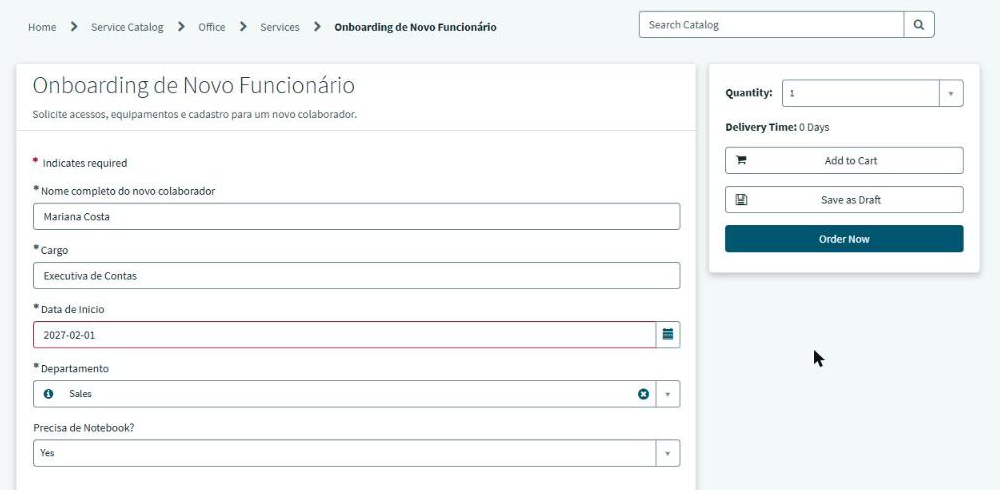
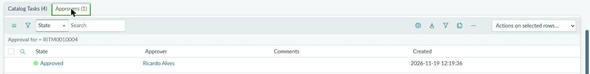
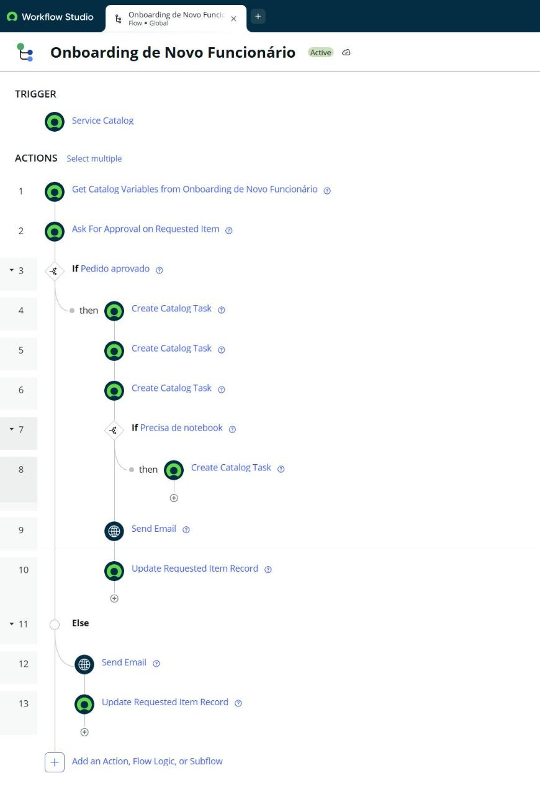
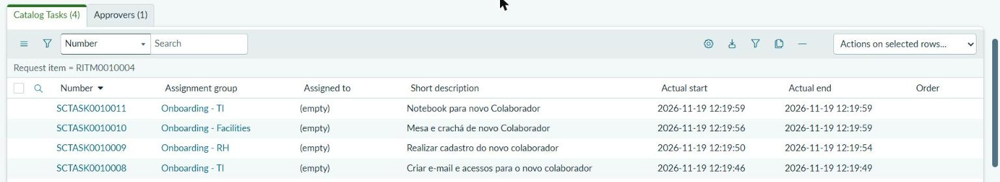
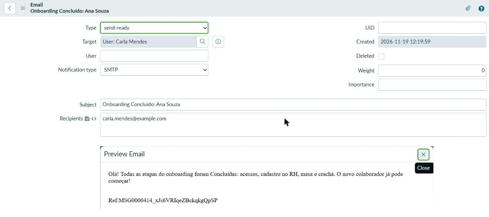
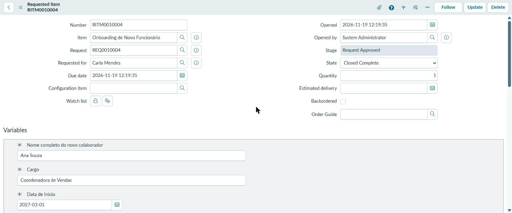

# Onboarding de Novo Funcionário — ServiceNow

Processo automatizado de **onboarding de colaboradores** construído no ServiceNow (release **Brazil**), usando **Service Catalog** e **Flow Designer / Workflow Studio**.

O gestor pede o onboarding pelo portal, o chefe dele aprova e o sistema distribui as tarefas para TI, RH e Facilities. No final, o gestor recebe um e-mail avisando que está tudo pronto.

---

## O problema

Em muitas empresas, a chegada de um novo colaborador depende de e-mails e mensagens soltas: a TI esquece o notebook, o RH não sabe a data de início, a mesa não fica pronta. Isso atrasa o primeiro dia de trabalho e passa uma má impressão.

## A solução

Um único pedido no portal dispara todo o processo, com aprovação, responsáveis definidos e rastreabilidade de ponta a ponta.

```
Gestor faz o pedido (Service Portal)
        │
        ▼
Aprovação do gestor imediato (Requested for → Manager)
        │
   ┌────┴─────────────┐
Aprovado          Rejeitado
   │                  │
   ▼                  ▼
Tarefa TI: e-mail e acessos      E-mail de rejeição ao solicitante
Tarefa RH: cadastro              Pedido fechado como Closed Incomplete
Tarefa Facilities: mesa e crachá
Tarefa TI: notebook (só se "Precisa de notebook?" = Sim)
   │
   ▼
E-mail "Onboarding concluído" ao solicitante
Pedido fechado como Closed Complete
```

---

## O que foi configurado

| Componente | Detalhe |
|---|---|
| **Catalog Item** | `Onboarding de Novo Funcionário` (Service Catalog › Services) |
| **Variáveis** | Nome do colaborador, Cargo, Data de início, Departamento (referência a `cmn_department`), Precisa de notebook? (Sim/Não) |
| **Grupos** | Onboarding - TI · Onboarding - RH · Onboarding - Facilities |
| **Flow** | Trigger Service Catalog · Get Catalog Variables · Ask For Approval · If/Else · Create Catalog Task (x4) · Send Email · Update Record |
| **Aprovação** | Dinâmica, pelo gestor de quem foi feito o pedido (dot-walking: *Requested for → Manager*) |
| **Lógica condicional** | Tarefa de notebook criada apenas quando a variável `precisa_notebook` = Sim |
| **Encerramento automático** | Pedido fechado como *Closed Complete* (aprovado) ou *Closed Incomplete* (rejeitado) |
| **Update Set** | `Onboarding de Novo Funcionário`, para exportar e reaproveitar a configuração |

---

## Testes realizados

| Cenário | Resultado esperado | Status |
|---|---|---|
| Pedido aprovado **com** notebook | 4 tarefas em sequência, e-mail de conclusão, pedido *Closed Complete* | ✅ |
| Pedido aprovado **sem** notebook | 3 tarefas, e-mail de conclusão, pedido *Closed Complete* | ✅ |
| Pedido **rejeitado** | Nenhuma tarefa, e-mail de rejeição, pedido *Closed Incomplete* | ✅ |

Os testes usaram usuários fictícios (*Carla Mendes*, gerente que faz o pedido, e *Ricardo Alves*, diretor que aprova) e o recurso **Impersonate** para simular cada perfil.

---

## Prints

### 1. Formulário do pedido no Service Portal


### 2. Aprovação feita pelo gestor imediato


### 3. Fluxo completo no Workflow Studio


### 4. Tarefas criadas para TI, RH e Facilities (incluindo o notebook)


### 5. E-mail de conclusão enviado ao solicitante


### 6. Pedido encerrado automaticamente (*Closed Complete*)


---

## Como importar

1. No ServiceNow, abra **System Update Sets › Retrieved Update Sets**.
2. Clique em **Import Update Set from XML** e envie o arquivo `.xml` deste repositório.
3. Abra o update set importado, clique em **Preview Update Set** e depois em **Commit Update Set**.
4. Crie os grupos *Onboarding - TI*, *Onboarding - RH* e *Onboarding - Facilities* (grupos e usuários não vão no update set).

---

## O que aprendi

- Transformar um processo de negócio em um fluxo automatizado, começando pelo desenho do processo antes de configurar
- Criar itens de catálogo e variáveis pensando em quem vai preencher
- Montar aprovações dinâmicas com dot-walking
- Usar lógica condicional (If/Else) no Flow Designer
- Testar caminhos diferentes (aprovado e rejeitado) e corrigir problemas encontrados nos testes

---

**Autor:** Gustavo Leite — ServiceNow | foco em processos e projetos (lado funcional)
